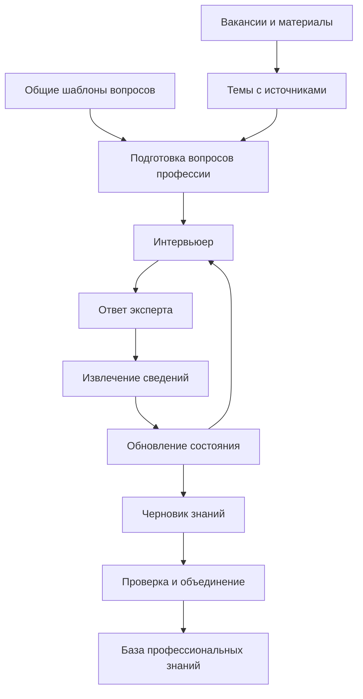
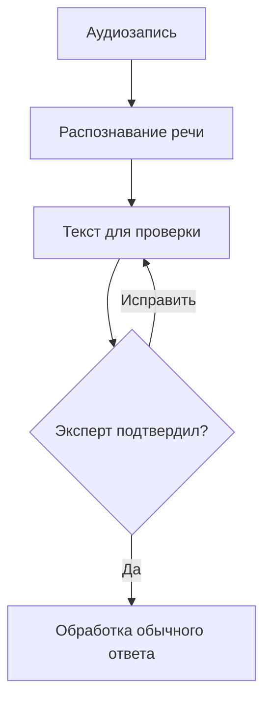

# Modeus: данные, вопросы и интервью

Версия 0.4. Обновлено: 16 ноября 2026 года.

Актуальный план MVP по итогам обсуждения. Основной интерфейс — web. Telegram — дополнительный интерфейс только для интервью, анкеты и управления сессиями, без просмотра карточек. Подробные решения, распределение задач и этапы реализации — в разделах 23–29.

Это проектная схема будущей реализации. Примеры профессии, текстов, чисел и идентификаторов демонстрационные. Описанные функции пока не реализованы в рамках этой работы.

## 1. Что строим

Modeus получает профессию, собирает сведения о её задачах, готовит вопросы, проводит адаптивное интервью и пополняет общую базу профессиональных знаний.

Три разных набора данных:

1. **Банк вопросов:** шаблоны и проверенные направления исследования. Здесь нет ответов экспертов.
2. **Материалы интервью:** фактически заданные вопросы, ответы и состояние конкретной сессии.
3. **База знаний:** структурированные описания задач, действий, решений, инструментов, ошибок и результатов, полученные из материала интервью.

Цитаты не являются форматом итоговой базы. Для исправлений и обновления сохраняется внутренняя связь записи с ответами и источниками. Исходные тексты не нужно многократно копировать в каждую запись знаний.

Эксперт может внести небольшой вклад, завершить сессию и продолжить позже. Система не требует объяснить всю профессию. Несколько экспертов пополняют одну базу с сохранением контекста и различий.

В MVP виртуальный эксперт находится ВНЕ приложения: система показывает вопрос, участник переносит его в ChatGPT, получает ответ и вставляет обратно. Для этого не требуется Persona Builder или API модели-эксперта. Такой материал получает неизменяемое происхождение `synthetic`.

## 2. Общая схема



Контур источников работает до интервью и обновляется отдельно. Контур интервью повторяется после каждого ответа. Объединение с общей базой выполняется после получения достаточного фрагмента или завершения сессии.

## 3. Какие объекты храним

Основное хранилище — PostgreSQL. JSON — формат обмена с моделями, API и экспорта. Аудио используется временно для распознавания и удаляется после обработки, включая ошибочные задания. Постоянных аудиоархивов, копий в логах и резервных копиях нет. Голосовые в Telegram остаются в переписке. Markdown подходит для инструкций и читаемых выгрузок.

| Объект | Что содержит | Кто записывает | Кто читает |
|---|---|---|---|
| Profession | Название, специализация, язык, область применения | Пользователь и реестр профессий | Все модули |
| SourceDocument | Оригинал источника, URL, дата, тип, хеш, рамка выборки | Сборщик | Аналитик и поиск |
| Topic | Нормализованная тема, тип, показатели, source IDs | Аналитик | Подготовка вопросов и интервьюер |
| QuestionTemplate | Общая цель вопроса, формулировка, искомые поля, условия | Команда, затем редактор | Построитель банка и планировщик |
| ProfessionQuestion | Проверенный вопрос или направление для профессии | LLM + валидатор + редактор | Планировщик |
| InterviewSession | Режим, область работы эксперта, версии, прогресс | Ядро интервью | Интервьюер и интерфейс |
| QuestionInstance | Точная формулировка заданного вопроса | Интервьюер | Интерфейс и анализ ответа |
| Answer | Исходный ответ и подтверждённая ревизия | API ответов | Извлечение и синтез |
| AnswerExtraction | Структура ответа, неизвестные поля, противоречия | LLM + проверки | Планировщик и синтезатор |
| KnowledgeItem | Структурированное знание о задаче | Синтезатор и редактор | Объединение, поиск, будущий эксперт |
| KnowledgeRelation | Дубликат, дополнение, вариант, возможное противоречие | Сервис сопоставления | Редактор и поиск |
| KnowledgeVersion | Версия опубликованного набора знаний | Сервис публикации | RAG, карта деятельности, экспорт |

У объектов есть постоянный ID, версия схемы, время создания и принадлежность исследованию. Сессия закрепляет версии банка, тем и промптов. Обновление рынка не переписывает уже заданные вопросы.

## 4. Откуда берутся темы

Пользователь вводит профессию, например Python backend-разработчик. Дополнительно полезны специализация, регион, период и цель исследования. Если готового пакета профессии нет, создаётся новая запись и запускается подготовка. Общие вопросы доступны даже при отсутствии источников.

Источники:

- вакансии: обязанности, задачи, требования, инструменты;
- профессиональные материалы: документация, стандарты, статьи;
- ранее проверенная база: известные задачи и пробелы;
- ответы текущего эксперта: новые темы, которых не было на рынке.

Сборщик загружает документы, а не готовые вопросы. Аналитик очищает текст, убирает дубликаты, извлекает сущности, нормализует термины и считает показатели. LLM помогает выделять смысловые группы, но не выдумывает численность выборки.

Пример источника:

```json
{
  "id": "src_101",
  "profession_id": "python_backend",
  "source_type": "vacancy",
  "external_id": "demo_vacancy_101",
  "url": null,
  "retrieved_at": "2026-11-16T09:00:00Z",
  "text": "Разработка API. Оптимизация запросов PostgreSQL.",
  "sample_id": "sample_01",
  "origin": "demonstration_fixture"
}
```

Пример темы:

```json
{
  "id": "topic_db_performance",
  "profession_id": "python_backend",
  "name": "Диагностика медленных запросов",
  "kind": "work_task",
  "related_tools": ["PostgreSQL"],
  "source_ids": ["src_101"],
  "market_stats": {
    "vacancy_count": 24,
    "sample_size": 100,
    "period": "demonstration"
  },
  "status": "candidate"
}
```

Доля темы считается по уникальным релевантным вакансиям. Повторы термина внутри вакансии не увеличивают число попаданий. Если знаменатель неизвестен, доля тоже неизвестна. Близость понятий не означает синонимию: SQL и PostgreSQL сохраняются раздельно. Новые термины поступают в кандидаты, а не отбрасываются только из-за отсутствия в словаре.

## 5. Как формируется банк вопросов

### Слой A. Универсальные шаблоны

Команда один раз готовит стартовый набор исследовательских шаблонов. Они подходят разным профессиям и задают намерение: получить случай, действие, причину решения, ошибку или критерий результата.

| Намерение | Шаблон вопроса | Что хотим получить |
|---|---|---|
| Обязанности | Какие задачи вы выполняете лично? | Границы роли |
| Контекст | В каких условиях вы обычно выполняете эту работу? | Область применимости |
| Задача | Какая задача требует от вас больше всего профессионального опыта? | Приоритетную деятельность |
| Эпизод | Вспомните недавний случай такой работы. Что произошло? | Конкретный случай |
| Запуск | По какому признаку вы поняли, что нужно начать? | Триггер |
| Входы | Какие сведения или материалы были доступны в начале? | Входные данные |
| Неопределённость | Чего вам тогда не хватало для решения? | Пробелы информации |
| Последовательность | Что вы сделали первым? | Действие |
| Продолжение | Что вы сделали после этого? | Порядок действий |
| Личное участие | Какую часть этой работы выполняли именно вы? | Ответственность |
| Наблюдение | На какую деталь вы обратили внимание? | Профессиональный сигнал |
| Решение | Почему вы выбрали такой способ? | Основание решения |
| Альтернатива | Какие другие варианты вы рассматривали? | Варианты выбора |
| Ограничение | Что мешало использовать обычный подход? | Ограничения |
| Инструмент | Для какого действия понадобился этот инструмент? | Связь действия и инструмента |
| Результат | Что получилось в итоге? | Выход работы |
| Качество | Как вы убедились, что задача решена правильно? | Критерий проверки |
| Ошибка | Что в такой работе чаще всего идёт не так? | Ошибки |
| Диагностика | По каким признакам можно заметить эту ошибку? | Способ обнаружения |
| Исправление | Что вы делаете, когда это происходит? | Восстановление |
| Опыт | Что новичок, скорее всего, пропустил бы? | Неявное знание |
| Частота | Как часто у вас возникает такая задача? | Частоту практики |
| Последствия | Что произойдёт, если выполнить её неправильно? | Значимость |
| Актуальность | Когда вы последний раз использовали этот подход? | Временную применимость |
| Изменение | Что в вашем подходе изменилось за последнее время? | Изменение практики |
| Взаимодействие | Кто передаёт вам задачу и принимает результат? | Рабочие связи |
| Уточнение | Правильно ли я понял ваше объяснение? | Проверку интерпретации |
| Расширение | О какой важной части работы мы ещё не поговорили? | Новые темы |

Шаблон хранится как объект, а не только строка:

```json
{
  "id": "tpl_quality",
  "version": 1,
  "intent": "quality_check",
  "template": "Как вы убедились, что {task} выполнена правильно?",
  "target_fields": ["quality_criteria"],
  "preconditions": ["task_known"],
  "skip_if": ["quality_criteria_already_known"],
  "status": "approved"
}
```

Условия здесь — условные коды правил приложения. Они не исполняются как произвольный код из JSON.

### Слой B. Вопросы профессии

Построитель банка получает темы, релевантные фрагменты источников и универсальные шаблоны. LLM предлагает вопросы под профессию. Например, из требования «оптимизация PostgreSQL» получается вопрос о последнем случае диагностики медленного запроса.

Проверки: один основной вопрос, нейтральность, связь с темой, отсутствие выдуманного факта об эксперте, отсутствие смыслового дубля, понятная цель. Сначала банк профессии быстро просматривает команда. В дальнейшем ручная проверка может применяться выборочно.

```json
{
  "id": "pq_db_case",
  "version": 1,
  "profession_id": "python_backend",
  "topic_id": "topic_db_performance",
  "template_id": "tpl_episode",
  "intent": "get_episode",
  "text": "Вспомните последний случай, когда пришлось разбираться с медленным запросом. С чего началась задача?",
  "target_fields": ["case", "trigger"],
  "source_ids": ["src_101"],
  "status": "approved"
}
```

`source_ids` объясняет выбор темы; источник не считается доказательством того, что эксперт выполняет такую работу.

### Слой C. Вопрос конкретного хода

После ответа возникают ситуативные уточнения: «Почему выбрали индекс?», «Что увидели в плане?». Они формируются по текущему ответу и сохраняются в журнале сессии. Автоматически добавлять каждое уточнение в общий банк нельзя: в нём останутся детали одного разговора. Повторно полезную формулировку можно позже обобщить и проверить.

## 6. Кто выбирает и формулирует вопрос

Планировщик работает в backend. Он читает банк и состояние сессии, выбирает исследовательскую цель. LLM-интервьюер формулирует вопрос в подходящих словах.

Пользовательский интерфейс не выбирает вопросы и не обращается напрямую к модели. Он отображает зафиксированный вопрос и передаёт ответ серверу.

Вход интервьюера: контекст эксперта, текущая задача, проверенное краткое состояние, несколько последних реплик, выбранное намерение, найденные источники при необходимости, ограничения разговора. Полную базу целиком в промпт не отправляем.

Выход — вопрос и технические поля:

```json
{
  "id": "q_007",
  "session_id": "session_01",
  "sequence": 7,
  "template_id": "tpl_quality",
  "topic_id": "topic_db_performance",
  "based_on_state_version": 12,
  "intent": "quality_check",
  "text": "Как вы проверили, что добавленный индекс помог?",
  "target_fields": ["quality_criteria"],
  "reason_code": "missing_quality_criteria"
}
```

Поля ID, sequence и версии назначает или проверяет сервер. Модель не управляет идентичностью и доступом.

## 7. Состояние интервью

```json
{
  "id": "session_01",
  "profession_id": "python_backend",
  "mode": "manual_simulation",
  "origin": "synthetic",
  "status": "active",
  "state_version": 12,
  "question_bank_version": 1,
  "current_activity_id": "activity_01",
  "coverage": {
    "context": "known",
    "trigger": "known",
    "actions": "known",
    "decisions": "partial",
    "quality_criteria": "unknown",
    "errors": "unknown"
  },
  "declined_topics": [],
  "out_of_scope_topics": [],
  "followups_without_new_information": 0
}
```

`known` означает наличие сведений в ответах. Оно не означает доказанную истинность практики. `partial` — сведения неполные. `unknown` — ответ не получен. Дополнительно нужны `not_applicable`, `declined`, `out_of_scope` с объяснением.

Пример правил планировщика:

| Состояние | Следующий шаг |
|---|---|
| Неизвестны обязанности | Уточнить роль |
| Есть общий ответ, нет случая | Попросить эпизод |
| Есть эпизод, нет действий | Восстановить последовательность |
| Назван выбор без причины | Уточнить основание |
| Нет проверки результата | Спросить критерий качества |
| Эксперт не занимается темой | Зафиксировать границу и сменить направление |
| Возникла новая важная задача | Добавить тему-кандидат |
| Два уточнения не дали новых сведений | Предложить другой пример или перейти дальше |
| Эксперт завершает | Остановить вопросы и сохранить частичный результат |

Ограничение двух уточнений — стартовая настройка, а не универсальный психологический закон. Нет требования пройти весь банк.

## 8. Путь текстового и голосового ответа

Текстовый ответ сначала сохраняется, затем анализируется. Предварительная обработка не должна удалять отрицания, менять смысл, переписывать термины или дополнять пропущенные шаги.

```json
{
  "id": "answer_007",
  "session_id": "session_01",
  "question_id": "q_007",
  "input_type": "text",
  "origin": "synthetic",
  "revision": 1,
  "status": "confirmed",
  "text": "Сравнил время выполнения на одинаковых запросах до и после изменения.",
  "confirmed_at": "2026-11-16T09:15:00Z",
  "client_message_id": "client_msg_007"
}
```

Голосовой ввод:



Сначала эксперт разрешает запись в web либо отправляет голосовое боту. Backend временно обрабатывает аудио и запускает STT, затем удаляет временные данные. Эксперт видит распознанный текст и кнопки «Подтвердить», «Исправить», «Ответить заново». Только подтверждённая ревизия участвует в извлечении. При ошибке распознавания можно повторить или ввести текст. Голосовое сообщение в Telegram не удаляем.

Постоянно сохраняем текст, его ревизию, статус подтверждения и технические сведения задания распознавания без аудиофайла и постоянной ссылки на него. Очистка временных аудиоданных выполняется при успехе, ошибке и отмене; зависшие задания очищаются по ограниченному сроку жизни. Исправление текста создаёт новую ревизию. Подтверждение расшифровки означает точность записи слов, а не истинность знаний.

Озвучивание вопроса — отдельная функция TTS. Она не нужна для голосового ввода и может быть добавлена позже. Full-duplex разговор с перебиваниями не входит в первый вариант.

## 9. Как разбираем ответ

Экстрактор получает текст вопроса, цель вопроса, подтверждённый ответ, текущий эпизод и краткую историю для понимания местоимений. Источник сведений должен быть явно указан: текущий или предыдущий answer ID. Модель не должна переносить знание из вакансии или своих общих знаний в слова эксперта.

Выход:

```json
{
  "answer_id": "answer_007",
  "answer_revision": 1,
  "facts": [
    {
      "type": "quality_criterion",
      "value": "Сравнение времени выполнения одинаковых запросов до и после изменения",
      "supporting_answer_ids": ["answer_007"]
    }
  ],
  "new_topics": [],
  "unknown_fields": ["acceptance_threshold", "frequency"],
  "contradiction_candidates": [],
  "needs_followup": true
}
```

Код проверяет схему, ID, ревизию, разрешённые типы, отсутствие ссылок на чужую сессию. Смысловую обоснованность нельзя доказать одной JSON Schema. При необходимости отдельный LLM-проход или редактор проверяет, не расширила ли модель утверждение. Неподтверждённое дополнение хранится как гипотеза, а не экспертное знание.

Отказ, неизвестность, неразборчивая запись, рассказ о чужом опыте и описанный неудачный подход имеют разные статусы. Описание ошибки не превращается в рекомендацию повторять её.

## 10. С чем сравниваем ответ

Это исследовательское интервью, поэтому нет единственного эталонного ответа и оценки человека по ключевым словам.

| Сравнение | Зачем | Кто выполняет |
|---|---|---|
| Ответ и цель вопроса | Понять, раскрыт ли нужный аспект | Экстрактор |
| Новые сведения и текущая карта | Найти дополнения и пробелы | Код + экстрактор |
| Текущий и предыдущие ответы | Обнаружить возможное противоречие | LLM, затем уточнение |
| Практика и рыночные темы | Найти расхождение, которое стоит обсудить | Планировщик и интервьюер |
| Новая запись и база | Найти дубликат, вариант или дополнение | Поиск + LLM-сопоставление |
| Распознанная речь и намерение говорящего | Устранить ошибку STT | Сам эксперт |

Пример: в вакансиях часто встречается Docker, а эксперт его не использует. Это не неверный ответ. Система уточняет, кто отвечает за окружение, и сохраняет границы роли.

## 11. Какие оценки используем

Отдельно храним полноту материала, частоту задачи, последствия ошибки и временную актуальность. Не используем общий рейтинг «качество эксперта».

| Показатель | Пример значения | Источник |
|---|---|---|
| Конкретность | Есть рабочий случай | Ответ |
| Полнота | Действия известны, критерий результата неизвестен | Состояние |
| Частота практики | Еженедельно / редко / неизвестно | Только слова эксперта |
| Последствия ошибки | Высокие, с объяснением / неизвестно | Ответ или отдельно гипотеза |
| Последнее применение | Дата, интервал / неизвестно | Ответ |
| Используется сейчас | Да / нет / неизвестно | Ответ |
| Распространённость на рынке | 24 из 100 вакансий | Расчёт аналитика |
| Проверка | Требует проверки / проверено редактором | Действие человека |

Свежесть интервью не доказывает свежесть рассказанной практики. Редкая операция может иметь высокую значимость. Отсутствие ответа не считается отрицанием. Числовая уверенность LLM не является откалиброванной вероятностью правильности.

## 12. Как появляется запись знаний

После нескольких ответов синтезатор собирает описание задачи. Он использует транскрипт и результаты извлечения, проверяет согласованность и отмечает неизвестное. Итоговый текст обобщён, без обязательных цитат.

```json
{
  "id": "knowledge_01",
  "version": 1,
  "profession_id": "python_backend",
  "task": "Диагностика медленного SQL-запроса",
  "context": {"database": "PostgreSQL", "team_type": "unknown"},
  "trigger": null,
  "actions": [
    {"id": "step_1", "text": "Изучить план выполнения", "supporting_answer_ids": ["answer_005"]},
    {"id": "step_2", "text": "Добавить подходящий индекс", "supporting_answer_ids": ["answer_006"]}
  ],
  "decisions": [],
  "tools": ["PostgreSQL"],
  "quality_criteria": [
    {"text": "Сопоставить время выполнения одинаковых запросов до и после изменения", "supporting_answer_ids": ["answer_007"]}
  ],
  "errors": [],
  "frequency": "unknown",
  "last_applied": null,
  "unknown_fields": ["trigger", "decision_conditions", "errors", "frequency"],
  "origin": "synthetic",
  "supporting_session_ids": ["session_01"],
  "status": "simulation_only"
}
```

Этот пример показывает неполноту: добавление индекса описано, но условия выбора ещё неизвестны. Система не должна достраивать их из общих знаний. ID предыдущих ответов здесь служат иллюстрацией связей, а не ссылками на реально проведённое интервью.

Частичный черновик можно сохранить в конце любого вклада. В реальной базе статусы: `draft`, `needs_review`, `reviewed`, `disputed`, `outdated`, `archived`. Происхождение и review — независимые поля: ручное принятие симуляции не делает её реальным опытом.

## 13. Объединение нескольких вкладов

Поиск отбирает похожие записи по профессии, задаче и условиям. При небольшом объёме достаточно терминов и фильтров; при большом помогают embeddings. Смысловая близость предлагает кандидатов, но не доказывает совпадение.

Далее LLM предлагает тип связи:

- `duplicate` — то же знание в тех же условиях;
- `extends` — дополнительный шаг или объяснение;
- `variant` — другой допустимый способ или условия;
- `contradiction_candidate` — возможное несовместимое утверждение;
- `unrelated` — похожие слова, разные задачи.

Для MVP сервис готовит предложение об объединении, редактор принимает содержательное изменение. Повторы не переписывают текст автоматически. Подтверждения считаются по независимым вкладам/экспертам, а не по количеству повторных реплик одного человека. Большинство не является гарантией истины.

Например, один эксперт использует EXPLAIN, другой EXPLAIN ANALYZE. Следует выяснить условия, доступ к среде и влияние измерения, а не объявлять ответы противоречием автоматически. Если один описывает ошибку, а другой рекомендуемый способ, это тоже разные типы сведений.

Старая версия сохраняется. Новая практика может сосуществовать с прежней, если условия различаются. «Устарело» требует основания, даты и контекста.

## 14. Модели и программные компоненты

Роли не равны отдельным моделям. Для первого варианта одна текстовая LLM обслуживает подготовку банка, интервью, извлечение и синтез разными вызовами с отдельными инструкциями.

| Компонент | Способ реализации | Начальная конфигурация |
|---|---|---|
| Загрузка вакансий | Код и API hh.ru | Адаптация существующего клиента |
| Очистка и подсчёт | Код | Дедупликация, словарь, счётчики |
| Группировка тем | LLM | Основная текстовая модель |
| Подготовка банка | LLM + проверка | Та же модель, отдельный промпт |
| Выбор следующей цели | Правила backend | Без отдельной модели |
| Формулировка вопроса | LLM | Основная текстовая модель |
| Разбор ответа | LLM со структурированным выводом | Та же модель, отдельная схема |
| Синтез и сопоставление | LLM + код + редактор | Та же модель, отдельные задачи |
| Распознавание голоса | STT | Выбирается после проверки |
| Смысловой поиск | Embeddings, необязательно на MVP | Выбирается при необходимости |
| Виртуальный эксперт | Внешний ChatGPT вручную | Модель в приложении не нужна |

Конкретные model ID пока не утверждены. Выбираем доступную текстовую LLM со структурированным выводом и STT по тестам на русском языке, профессиональных терминах, задержке и стоимости. Модели задаются конфигурацией, их фактические версии сохраняются в заданиях. Для ручного теста эксперт — внешний ChatGPT; встроенный генератор ответов не нужен.

## 15. Инструкции для ролей

**Построитель вопросов:** предложи нейтральные вопросы из тем и шаблонов. Укажи цель каждого. Не утверждай, что эксперт использует технологию. Отдели требование вакансии от описанной рабочей задачи. Верни структурированные кандидаты, не готовые знания о профессии.

**Интервьюер:** задай один основной вопрос по выбранному намерению. Опирайся на слова эксперта. Проси конкретные случаи, раскрывай действия, решения и качество. Уважай отказ и границы. Не экзаменуй и не подсказывай ответ. При отсутствии материала сохрани пробел.

**Экстрактор:** извлеки только сведения из указанных ответов. Сохрани отрицания, неопределённость и контекст. Для каждого сведения укажи поддерживающие answer IDs. Не делай из описания ошибки рекомендацию. Не дополняй ответ собственными профессиональными знаниями.

**Синтезатор:** собери обобщённое описание задачи. Сохрани неизвестные поля и границы применимости. Гипотезы отдели от сведений эксперта. Не добавляй предполагаемые шаги ради красивой последовательности.

**Сопоставитель:** сравни две записи с учётом условий, времени и типа утверждения. Предложи тип связи и объясни его кратко. При неоднозначности запроси проверку, не перезаписывай базу.

## 16. Где нужен RAG

RAG — поиск подходящих сведений перед вызовом LLM. Это не отдельная обязательная модель и не обучение LLM на наших данных.

Первое применение: при подготовке темы и вопроса найти фрагменты вакансий и материалов. Второе: при объединении знаний найти похожие записи. Третье, после пилота: виртуальный эксперт ищет проверенные записи профессии и отвечает на пользовательский вопрос.

Индекс поиска — производный объект. Основные знания остаются в БД. При правке записи индекс обновляется. Embeddings от разных моделей не смешиваются в одном пространстве поиска; версия индекса хранит model ID.

Интервьюер не должен подменять ответ эксперта найденным в базе шаблонным ответом. Поиск задаёт контекст и помогает уточнять. При пустом поиске остаются универсальные вопросы.

## 17. Один ход целиком

1. API сохраняет подтверждённый ответ с ID и ревизией.
2. Экстрактор выделяет новые сведения.
3. Валидатор проверяет структуру и ссылки.
4. Backend обновляет карту и состояние одной фиксируемой операцией.
5. Планировщик выбирает цель следующего вопроса или завершение.
6. При необходимости поиск получает релевантные источники.
7. LLM формулирует вопрос.
8. Backend проверяет ограничения и сохраняет вопрос.
9. UI показывает его пользователю.

Ответ → извлечение → обновление состояния → следующий вопрос выполняются последовательно. Аналитику и независимую подготовку контекста можно выполнять параллельно. Устаревший результат не применяют к новой версии состояния.

На MVP это обычно два текстовых LLM-вызова на ответ: извлечение и формулировка. Начальный вопрос — один вызов, завершение может обойтись без нового вопроса. Синтез и сопоставление выполняются отдельно, а не обязательно на каждом ходе. Голос добавляет вызов STT. Внешние ручные ответы эксперта приложение не генерирует.

## 18. API, сохранность и ошибки

| Операция | Пример маршрута | Результат |
|---|---|---|
| Создать подготовку | `POST /professions/{id}/question-bank-jobs` | Job ID |
| Прочитать банк | `GET /professions/{id}/questions` | Версия и вопросы |
| Создать интервью | `POST /interviews` | Session ID |
| Начать | `POST /interviews/{id}/start` | Первый вопрос |
| Передать текст | `POST /interviews/{id}/answers` | Answer ID и job |
| Загрузить голос | `POST /interviews/{id}/audio` | Job STT и черновик ответа; аудио временное |
| Подтвердить текст | `POST /answers/{id}/confirm` | Подтверждённая ревизия |
| Смотреть состояние | `GET /interviews/{id}` | Состояние и текущий вопрос |
| Получать события | `GET /interviews/{id}/events` | SSE по сохранённым event IDs |
| Пауза/продолжение | `POST /interviews/{id}/pause`, `/resume` | Новый статус |
| Завершить | `POST /interviews/{id}/finish` | Job синтеза |
| Проверить знания | `GET /interviews/{id}/knowledge-draft` | Частичный черновик |
| Принять правки | `POST /knowledge/{id}/review` | Новая версия |

Текст передаётся в POST body. SSE используется для событий, а не передачи нового ответа через URL. Ответ имеет idempotency key и ожидаемую версию сессии: повторная отправка не создаёт второй ход. У одной сессии один писатель состояния. Доступ проверяется по владельцу исследования.

Если LLM недоступна, ответ остаётся сохранённым, job получает ошибку и может быть повторён. Ошибка не маскируется как пустой экспертный ответ. Если превышен бюджет, сессия приостанавливается с объяснением. Отказ модели или неверный JSON не становится знанием. Если распознавание не удалось, доступен текстовый ввод.

После исправления ответа зависимые извлечения и знания помечаются на повторную обработку. Перезапуск задания не создаёт дубликат записи. Экспорт привязан к конкретной версии.

## 19. Проверка на одном сквозном примере

Источник говорит об оптимизации PostgreSQL. Аналитик создаёт тему «Диагностика медленных запросов». Построитель банка предлагает вопрос о конкретном случае. Эксперт рассказывает, что проверил план выполнения и добавил индекс. Экстрактор заполняет действия, но замечает отсутствие проверки результата. Планировщик выбирает `quality_check`. Интервьюер спрашивает, как проверили пользу индекса. Ответ добавляет критерий сравнения времени. Синтезатор формирует частичную запись и оставляет неизвестными условия выбора, ошибки и частоту.

В ручном тесте все ответы приходят из внешнего ChatGPT. Происхождение всей цепочки — synthetic. В реальном интервью те же API принимают ответы человека и маркируют их human. Интерфейс и ядро одинаковы.

## 20. Связь с будущим skill и виртуальным экспертом

После проверки реальные знания объединяются в версионируемый набор профессии. Карта деятельности — читаемое представление этих записей. JSON — экспорт для программной обработки. Skill задаёт роль и правила доступа к знаниям, а обновляемая база хранится отдельно.

Будущий виртуальный эксперт: вопрос пользователя → определение задачи и условий → поиск по проверенной базе → подходящие записи → ответ LLM. При нехватке сведений он задаёт уточнение или сообщает об ограничении. Время интервью и последнее применение практики хранятся раздельно. Обновления базы не требуют переобучать модель.

Роадмап — отдельный следующий слой, которому нужны цель пользователя, начальные знания и зависимости между действиями. Из одной карты нельзя автоматически получить корректный персональный план без этих входов.

## 21. Что нужно реализовать первым

Обязательный минимум: импорт источников, темы с provenance, универсальные шаблоны, банк профессии, сессии и журнал, планировщик, LLM-интервьюер, извлечение, черновик знаний, ручная проверка, изоляция симуляции и экспорт. Голос подключается после текстового цикла. Embeddings и сложное объединение можно добавить после простого поиска и ручных предложений.

В текущей папке проекта при проверке 16.11.2026 находится этот документ; исходников приложения нет. Упомянутый ранее внешний репозиторий — кандидат на переиспользование, а не уже подключённая кодовая база. При его подключении нужно отдельно проверить парсинг, LLM-клиент и интерфейс чата. Новый модуль интервью должен иметь собственные состояние, контракты и правила.

Контрольные проверки: вопрос меняется по содержанию ответа; уже известное не спрашивается повторно; отказ прекращает ветку; новая тема сохраняется кандидатом; unknown не превращается в выдумку; голос подтверждается до анализа; две отправки не дают двух ходов; исправление ответа обновляет зависимые записи; синтетические знания не попадают в реальную базу; объединение не уничтожает контекст.

## 22. Выбор провайдеров и внешних зависимостей

Ссылки и конкретные модели из версии 0.1 не являются утверждёнными зависимостями. Перед интеграцией проверяем доступность API, реальные идентификаторы моделей и условия обработки данных по актуальной документации выбранного провайдера. В этом обновлении сетевой проверки и запуска приложения не было.

## 23. Четыре роли и общий договор

| Роль | Задачи | Результат и граница готовности |
|---|---|---|
| 1. Источники и банк вопросов | Импорт выбранных вакансий и материалов, очистка, дубликаты, темы, универсальные шаблоны, вопросы профессии | Для одной профессии есть проверенный набор тем и вопросов с целями и происхождением; новые темы не теряются |
| 2. Интервью | Планировщик, LLM-интервьюер, сессии, покрытие, пауза и продолжение, пропуски и отказы | Следующий вопрос учитывает ответ; известное не спрашивается повторно; отказ прекращает ветку; состояние восстанавливается |
| 3. Web и Telegram | Вход, профиль, привязка аккаунтов, интерфейс интервью, голос и подтверждение, web-каталог и рабочие экраны | Сквозной web-сценарий работает; Telegram подключается к тем же API, но не показывает карточки; аудио удаляется из временного хранения |
| 4. База знаний | Извлечение, синтез карточек, происхождение, проверка, версии, сопоставление повторов, поиск | Неизвестные поля не выдумываются; карточки проходят редактора; объединение сохраняет контекст и историю |

Главный чат согласует архитектуру, границы MVP, схемы, API, интеграцию и демонстрацию. Источник истины — файлы репозитория. Рабочие чаты не синхронизируют решения автоматически. Разработчики работают в отдельных ветках; изменения общих контрактов согласуют заранее.

Сначала фиксируем User, AuthIdentity, ProfessionalProfile, InterviewSession, QuestionInstance, AnswerRevision, AnswerExtraction, KnowledgeItem, KnowledgeVersion, Contribution и ReviewDecision. У каждого объекта постоянный ID и серверные права доступа. Сессия хранит снимок профессионального контекста, чтобы изменение профиля не переписывало старый опыт.

Минимальный общий договор: идентификаторы, версии состояния и ревизий, правила подтверждения, статусы, обработка повторных запросов, происхождение, контур данных и доступ. Схемы JSON валидируются backend, а не только промптом.

## 24. Web, профиль, аккаунты и Telegram

Основной интерфейс — web: вход, профессиональные профили, мои интервью, экран интервью, мой вклад, открытый каталог для показа на хакатоне и редакторская проверка. Каталог оставляем в текущем MVP; необходимость публичного каталога в итоговом продукте решим отдельно. Открытый каталог доступен без регистрации; личные сессии и вклад требуют входа. Для MVP предлагаем вход по одноразовому коду на почту.

Анкета: профессия, специализация, опыт, текущая роль, реальные обязанности, сфера и значимые условия. Заполняется один раз, затем обновляется. При новой сессии кратко подтверждаем актуальность. Несколько профессий — несколько профилей одного пользователя. Сведения анкеты первоначально заявлены пользователем; они не равны проверке квалификации.

Telegram служит только для интервью и необходимого обслуживания: анкета чатом, выбор профиля, новая сессия, продолжение, текст и голос, исправление расшифровки, пропуск, пауза, завершение. Просмотра своих и общих карточек в боте нет. Итог разобранной задачи можно подтвердить как часть интервью; каталог и работа с карточками находятся в web.

Связь аккаунтов: пользователь входит в web → получает одноразовую ссылку на бота → открывает её в Telegram → подтверждает привязку. Код ограничен по времени, используется однократно, не раскрывает идентификаторы доступа. По имени и username аккаунты не объединяем. Если первым был Telegram, создаём внутреннего пользователя и позже подключаем web-вход. Два существующих аккаунта объединяем только после подтверждения владения обоими. Профили и сессии едины для обоих каналов; одновременные изменения контролируются версиями.

## 25. Как работает планировщик

Планировщик в MVP — алгоритм с правилами в backend. Он выбирает цель следующего вопроса, не суммирует ответы и не создаёт карточки.

| Компонент | Реализация | Ответственность |
|---|---|---|
| Экстрактор | LLM | Выделяет из ответа действия, решения, инструменты и пробелы |
| Планировщик | Алгоритм backend | По состоянию и извлечённым сведениям выбирает цель вопроса |
| Интервьюер | LLM | Формулирует вопрос для выбранной цели |
| Синтезатор | LLM | Собирает из нескольких ответов черновик карточки |

Для трёх LLM-задач можно использовать одну модель с разными инструкциями и схемами вывода. Экстракция выполняется после ответа, синтез — после связанного разбора задачи, а не обязательно на каждом ходе.

Последовательность: подтверждённый ответ → извлечение сведений → обновление покрытия → проверка отказов и ограничений → выбор полезного пробела → подходящий шаблон → LLM-формулировка → сохранение и показ вопроса.

Пример: эксперт сообщил, что добавил индекс. Система знает действие, но не знает основания выбора и проверки результата. Планировщик выбирает один пробел, например quality_check. LLM задаёт вопрос о проверке результата. Если ответ сразу раскрыл и проверку, и основания решения, оба поля обновляются, лишний вопрос пропускается.

Приоритеты: команда эксперта остановиться/пропустить → уточнение существенной неоднозначности → недостающие сведения текущей задачи → следующая тема → итог. Стартовый предел — два уточнения без новой информации, затем другой пример или переход дальше. Эксперт не обязан закрыть все поля.

## 26. Черновики и публичные карточки

Предлагаемое разделение видимости:

| Объект | Эксперт | Другие посетители | Редактор |
|---|---|---|---|
| Сырая экстракция и технические задания | Не показываем как карточки | Нет | Служебный доступ при необходимости |
| Оформленный черновик задачи | В разделе «Мой вклад», можно дополнить и исправить | Нет | Доступ к материалу, переданному на проверку |
| Карточка на проверке | Видны статус и замечания | Нет | Проверка и решение |
| Опубликованная карточка | Да | Да, в web-каталоге | Управление версиями и проверкой |
| Неполный или отклонённый материал | Сохраняется приватно с причиной; можно доработать | Нет | По правилам проверки |

Черновики не засоряют общий каталог: отдельная вкладка «Мой вклад» с фильтрами «Черновики», «На проверке», «Опубликовано». Технические промежуточные результаты туда не выводим. Предусматриваем архивирование и удаление с учётом зависимостей и политики хранения, а не бессрочное накопление без управления.

Публичная карточка в текущем MVP для хакатона — обобщённая практика, доступная посетителям web-каталога. В итоговом продукте публичность карточек может быть убрана; внутренняя база знаний и личные черновики от этого не зависят. Это не публикация чата, аудио или профиля по умолчанию. Перед публикацией эксперт просматривает итог и соглашается на публичное размещение; имя и авторство показываются по его выбору. Редактор проверяет пригодность и отсутствие сведений, которые не должны раскрываться.

Компактный вид в каталоге: название задачи, профессия/теги, краткое описание, дата актуальности и статус проверки. Подробный экран: контекст, запуск, действия, основания решений, инструменты, результат, критерии проверки, ошибки, ограничения, пробелы и доступные сведения об источниках. Действия: дополнить опытом, сообщить об изменении. Внутренние ссылки на ответы не открывают чужую переписку.

Карточки — записи самой базы знаний. Одна карточка может относиться к нескольким профессиям, одно интервью даёт несколько карточек, несколько вкладов дополняют одну карточку.

Состояние публикации (draft, in_review, published, archived) храним отдельно от состояния проверки (unreviewed, reviewed, disputed, needs_refresh). «Прошла редакторскую проверку» не означает «абсолютная истина». Для обновления опубликованной карточки создаётся новая черновая версия, предыдущая остаётся доступной до принятия изменений, если не выявлена причина снять её с публикации.

## 27. Ручные проверки и показ на хакатоне

Делаем единый пользовательский сценарий без обязательных демо-плашек, отметок на карточках, переключателя test/live и отдельного тестового Telegram-бота. Публичный web-каталог оставляем для хакатона: он показывает, как из интервью получается общая база знаний. Это не обязательство сохранять публичный каталог в итоговом продукте.

Ручная проверка: вопрос системы → внешний ChatGPT → перенос ответа в интервью → уточнения → черновик → проверка → карточка в каталоге. Этот способ проверяет работу механизма, но сам по себе не подтверждает профессиональную достоверность материала.

Происхождение human/synthetic сохраняем как внутренние технические данные без обязательного отображения в пользовательском интерфейсе. Human означает ответ человека, а не проверенную квалификацию. Статус проверки и происхождение независимы; принятие карточки не меняет её происхождение. Синтетический вклад нельзя считать независимым подтверждением реального опыта. При дальнейшем использовании базы поиск и экспорт должны учитывать происхождение, чтобы материалы ручных проверок не выдавались за проверенные реальные практики.

Показ процесса на хакатоне не требует отдельного продуктового режима. В презентации происхождение использованных примеров описываем корректно. Вопрос разделения окружений решается при внедрении, не добавляя сейчас отдельные интерфейсы и обязательные индексы только ради показа.
## 28. Проверка качества и работа с повторениями

Точность расшифровки подтверждает эксперт; точность интерпретации — просмотр итога; профессиональный контекст в пилоте проверяется вручную у приглашённых специалистов. Достоверность практики проверяется сопоставлением независимых материалов, контекста и редакторской/экспертной проверкой. LLM помогает обнаружить проблему, но не гарантирует её обнаружение.

Общий ответ → конкретный пример; неполный → уточнение; возможная ошибка → основания и проверка; другие условия → вариант; реклама и бессмыслица → не публикуем. Сообщаем причину и способ доработки материала, не ставим публичный общий балл эксперту. Если данных недостаточно, вклад остаётся приватным частичным черновиком. Систематические нарушения рассматривает модератор отдельно от обычной неполноты.

Сначала ищем похожие записи фильтрами и текстовым поиском, при необходимости embeddings; LLM получает несколько кандидатов, не всю базу. Сопоставление запускается после связанного разбора задачи. Повтор одного человека не считается независимым подтверждением. Повтор другого специалиста после проверки становится связанным вкладом, а не новой одинаковой карточкой. Частичное дополнение предлагает новую версию; различия условий и противоречия не стираются. Большинство не является доказательством.

Актуальность: сохраняем отдельно дату интервью, последнего применения практики и проверки. Период обновления зависит от темы и задаётся позже по пилоту. Истечение срока означает «нужна проверка», а не автоматическую ложность знания.

## 29. Порядок реализации и критерии MVP

| Этап | Задачи | Проверяемый результат |
|---|---|---|
| 1. Общие контракты | Одна профессия, схемы, статусы, API, права и внутреннее происхождение данных | Четыре роли используют одинаковые определения |
| 2. Текстовый web-сценарий | Вход, профиль, небольшой ручной банк, сессия, ответ, извлечение, уточнение | Можно пройти и продолжить интервью без потери ответов |
| 3. Карточки и публикация | Синтез, приватный черновик, исправления, согласие, редактор, каталог | Из интервью получается опубликованная карточка с происхождением |
| 4. Источники и повторы | Импорт вакансий/материалов, темы, поиск похожих, предложения объединения | Вопросы имеют основания; дубликаты не размножаются |
| 5. Голос в web | STT, подтверждение ревизии, удаление временного аудио | Ошибку распознавания можно исправить до анализа |
| 6. Telegram | Привязка, анкета, сессии, текст и голос на общих API | То же интервью доступно через бота; просмотра карточек нет |

Общую модель данных и каналы учитываем с первого этапа, полноценного бота не требуется делать одновременно с web.

Контрольные сценарии: полный и неполный ответ, отказ, смена темы, новая профессия, пауза, продолжение, сбой LLM, повторная доставка сообщения, исправление уже обработанного ответа, устаревший результат задания, противоречие, повтор карточки, запрет доступа к чужому черновику, учёт происхождения при поиске и экспорте. Для голоса проверяем очистку при успехе, ошибке и отмене.

Показ на хакатоне: профиль → тема → несколько ответов → содержательное уточнение → итог → приватный черновик → редактор → публичный web-каталог. Специальные плашки и пометки режима не требуются. Тестирование через ChatGPT проверяет механизм, а качество реальных практик и интервью затем проверяется с людьми.

Следующий слой Modeus: проверенные карточки → поиск для виртуального эксперта. Для плана под вакансию дополнительно нужны диагностика знаний человека, предварительные зависимости, учебные цели, задания, критерии оценки и материалы. Генератор планов не входит в первый сквозной MVP интервью.

Текущее состояние на 16.11.2026: обновлён проектный документ; приложение, API, миграции и тесты в этой папке ещё не созданы. Следующий конкретный шаг — проверка кодовой основы из раздела 30 и фиксация исполняемых схем/API для этапа 1.

## 30. Переиспользование GitHub-проекта

Кандидат на кодовую основу: https://github.com/kr1p043k/compare_competencies . В предыдущем обсуждении рассматривался снимок `9990d8b2e188722e89ef700889a14b89e25d8955`. Это ориентир для проверки, а не утверждение о текущем состоянии репозитория. Код пока не подключён к этой папке; приведённые ниже пути и возможности требуют проверки в выбранной версии.

Цель — использовать готовую работу с рынком и оболочку приложения, сосредоточив новую разработку на интервью и накоплении профессиональных знаний. Не переносим весь проект автоматически.

### Что планируем взять и адаптировать

| Возможность исходного проекта | Применение в Modeus | Что проверить или изменить | Ответственная роль |
|---|---|---|---|
| Сбор вакансий, клиент API и парсинг; ранее упоминался `src/parsing/` | Загрузка материалов для тем интервью | Работоспособность, настройки доступа, очистку, дубликаты, сохранение происхождения и дат | 1 |
| Словари профессий и терминов | Нормализация профессий, навыков и инструментов | Покрытие выбранной профессии; сохранение новых терминов кандидатами | 1 |
| Аналитика требований рынка | Приоритизация тем и рабочих задач | Реальные возможности расчётов, состав выборки, подсчёт по уникальным вакансиям; спрос не считать доказательством правильности практики | 1 |
| LLM-клиент; ранее упоминался `src/services/llm_client.py` | Общий доступ к модели для вопросов, извлечения и синтеза | Доступных провайдеров, структурированный вывод, обработку ошибок, таймауты, конфигурацию моделей | 2 совместно с 4 |
| Кеширование LLM; ранее упоминался `llm_cache.py` | Повторное использование подходящих результатов | Учёт версии промпта, модели, схемы, контекста и ревизии; исключить смешивание чужих сессий и устаревших данных | 2 совместно с 4 |
| Backend и работа с БД | Основа API, хранения и фоновой обработки | Стек, миграции, права доступа, модель пользователей; добавить сущности интервью и знаний, не подменять их обычными сообщениями | 2, 3 и 4 по своим сущностям |
| Frontend и интерфейс чата; ранее упоминался `LlmChatPanel.tsx` | Основной web-интерфейс интервью | Инициативу интервьюера, состояние обработки, паузу, продолжение, пропуск, подтверждение голоса; убрать зависимость от обычного вопросно-ответного чата | 3 |
| Образовательные данные и существующие учебные программы, если доступны | Будущая связь практик с обучением | Состав и пригодность данных, связи с навыками и задачами; не блокировать ими MVP интервью | 1 совместно с 4, после первого цикла |

### Что разрабатываем заново

| Новый модуль | Почему существующей оболочки недостаточно | Ответственная роль |
|---|---|---|
| Банк исследовательских шаблонов и вопросов профессии | Нужны цели, условия применения, пропуска и версии | 1 |
| Состояние интервью и покрытие задачи | Обычная история сообщений не хранит полноту, отказы и пробелы | 2 |
| Алгоритм-планировщик | Выбирает следующую цель по извлечённым сведениям и правилам | 2 |
| LLM-интервьюер и его инструкции | Должен раскрывать деятельность, а не отвечать за эксперта | 2 |
| Экстрактор и схемы извлечения | Нужны обоснованные сведения со связями на ревизии ответов | 4 |
| Синтезатор карточек | Собирает описание практики из нескольких ответов, сохраняя неизвестные поля | 4 |
| Проверка, версии и сопоставление вкладов | Нужны черновики, решения редактора, дополнения, варианты и противоречия | 4 |
| Личный раздел черновиков и каталог для хакатона | Новые пользовательские представления данных интервью и базы знаний | 3 совместно с 4 |

Ранее упомянутый `action_map.py` рассматриваем только как возможный справочник сопоставления действий и инструментов после проверки кода. Он не заменяет экстрактор, планировщик или базу профессиональных практик.

### Возможности, по которым сначала нужен аудит

Регистрация, вход, роли, профессиональные профили, связь web и Telegram, голосовой ввод, STT и подтверждение расшифровки проверяются отдельно. Если подходящая реализация есть — адаптируем; иначе разрабатываем. Наличие этих функций в исходном проекте не предполагаем. За пользовательские сценарии отвечает роль 3, за общие контракты — главный чат совместно с владельцами сущностей.

XGBoost, SHAP, прогнозирование, n8n и расширенный мониторинг не входят в обязательный перенос для MVP интервью. Их подключение должно быть обосновано конкретной задачей; наличие в исходном проекте не делает их необходимыми.

### Порядок подключения к плану разработки

1. До этапа 1 проверить инструкции репозитория, лицензию, зависимости, выбранную версию, способ запуска и конфигурацию. Не переносить секреты и чужие пользовательские данные.
2. Зафиксировать результаты аудита: какие пути и возможности подтверждены, что переносим, адаптируем, заменяем или откладываем. Сохранить исходный commit для воспроизводимости.
3. Запустить минимальную основу и проверить выбранные компоненты: получение вакансий, вызов LLM, работу БД и web-оболочки. Если компонент не работает, оценить ремонт или замену, не считать его готовым.
4. Согласовать схемы/API Modeus с фактическим стеком. Дальше выполнять этапы раздела 29, используя подтверждённые компоненты и отдельные новые модули интервью.
5. Проверить общий путь: источник → тема → интервью → уточнение → приватный черновик → проверка → карточка в web-каталоге для хакатона.

Критерий готовности переиспользования — подтверждённая работа нужного компонента в Modeus, а не наличие похожего файла в исходном репозитории. В рамках обновления этого плана новый аудит GitHub-кода и запуск приложения не выполнялись.
